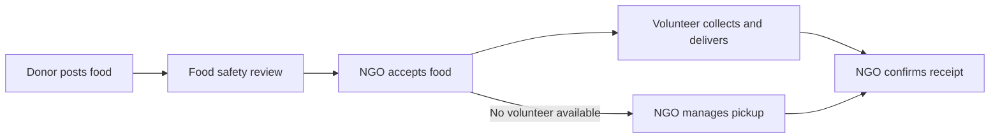

# SharePlate

SharePlate helps communities move surplus food from donors to people who need it. Donors post food, NGOs review and accept it, and volunteers can collect and deliver it. NGOs can also manage a donation directly.

## How it works



Each role has its own account and workspace. Listings include food details, pickup times, location, and photos. Food photo screening and payments are optional integrations; human review is available when automated screening is not configured or cannot decide.

## Try it locally

You need Python 3.13 or later.

```bash
git clone <repository-url>
cd shareplate-master
python -m venv .venv
source .venv/bin/activate
pip install -r requirements.txt
cp .env.example .env
python manage.py migrate
python manage.py runserver
```

Open <http://127.0.0.1:8000/>. The local setup uses SQLite and does not require third-party API keys. On Windows, activate the environment with `.venv\Scripts\Activate.ps1`.

## Learn more

The [documentation index](docs/README.md) links to simple guides for each part of the project:

- [Project and workflow](docs/project.md) — roles, donation lifecycle, and main capabilities.
- [Frontend](docs/frontend.md) — templates, styles, scripts, and page structure.
- [Backend](docs/backend.md) — Django apps, request flow, permissions, and integrations.
- [Database](docs/database.md) — models, relationships, migrations, and storage.
- [Development](docs/development.md) — local setup, configuration, demo data, and useful commands.
- [Deployment](docs/deployment.md) — production architecture and Render deployment.
- [Demo walkthrough](docs/demo-presentation.md) — sample accounts and presentation steps.

## Built with

Django and Python, HTML templates, CSS, JavaScript, SQLite for local development, and PostgreSQL in production. Docker, Gunicorn, and WhiteNoise are used for deployment.
