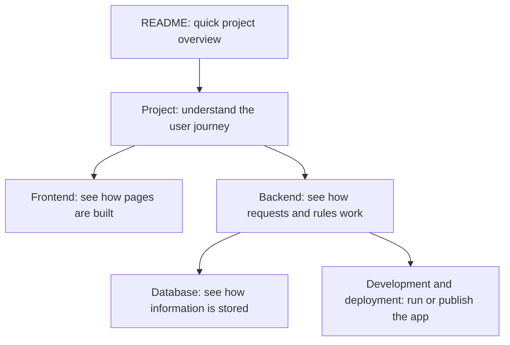

# SharePlate documentation

Start with [the project guide](project.md) for a plain-language description of the product. Use the topic guides below when you want technical details.

| Guide | What it covers |
| --- | --- |
| [Project and workflow](project.md) | User roles, donation journey, and product features |
| [Frontend](frontend.md) | Django templates, CSS, JavaScript, and page layout |
| [Backend](backend.md) | Django apps, request handling, permissions, and integrations |
| [Database](database.md) | Main data models, relationships, migrations, and uploaded files |
| [Development](development.md) | Local setup, environment settings, demo data, and commands |
| [Deployment](deployment.md) | Production services, Render setup, and release checklist |
| [Demo walkthrough](demo-presentation.md) | Demonstration accounts and guided walkthrough |

## Start here

