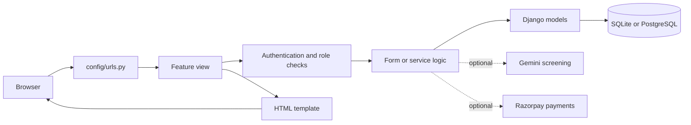

# Backend

The backend is a Django project. URL routes send each request to a view. Views handle forms and permissions, use models and service modules for application work, and render a template or return a response.

## Main apps

| App | Responsibility |
| --- | --- |
| `accounts/` | Custom email-based user, registration, login, and role checks. |
| `donors/` | Donor profile and donor dashboard. |
| `donations/` | Food listings, safety verification, NGO review, and donation lifecycle. |
| `volunteers/` | Volunteer profile, pickup assignment, location, and delivery tracking. |
| `ngos/` | NGO profile, approval, and organization dashboard. |
| `payments/` | Optional Razorpay connection, payment, and payout workflows. |
| `bridge/` | Public pages, health endpoint, location helpers, and demo-data command. |
| `config/` | Project settings, top-level routes, and ASGI/WSGI entry points. |

The route table in `config/urls.py` includes each app's routes. Feature-specific work is kept in its app; shared workflows may use a `services.py` module.

## Request and data flow

## Access and safety rules

The custom user has a role: donor, volunteer, or NGO. Profiles are linked to their user. Views and decorators restrict role-specific actions. NGO and volunteer profiles can require approval. Donation and pickup states control which actions are available at each step. Delivery requires evidence, and an NGO confirms receipt before the donation is complete.

Optional services are configured with environment variables. Without a Gemini key, food listings can go through human review. Razorpay routes are disabled unless `FOODBRIDGE_PAYMENTS_ENABLED=true` and configured; do not enable them until credentials and webhook behavior are ready.

See [database](database.md) for records and relationships, and [development](development.md) for commands and configuration.
