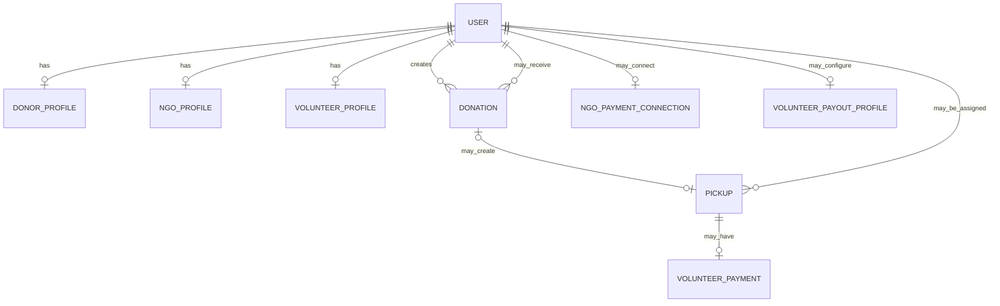

# Database and uploaded files

Django models describe the data and migrations change its structure over time. Local development uses a SQLite file. Production settings require PostgreSQL through `DATABASE_URL`.

## Main records



- **User** is the shared account and role record. A user can have one role-specific profile.
- **Donation** stores food details, photos, pickup information, review status, and donation status.
- **Pickup** stores assignment, collection, destination, and delivery proof details.
- **VolunteerPayment** tracks an optional payment for a completed volunteer delivery.
- Payment connection and payout profile records store provider or payout details only when that optional feature is configured.

The relationships above show the main domain records, not every foreign key. Refer to each app's `models.py` for field-level details.

## Migrations

Migration files are in each app's `migrations/` directory. Apply them with:

```bash
python manage.py migrate
```

When changing a model, create and review a migration before applying it:

```bash
python manage.py makemigrations
python manage.py migrate
```

Do not edit an already-applied migration to change a database in place; create a follow-up migration.

## Uploaded files

Uploaded food photos, delivery proof, and NGO receipts are stored under the media directory. Local settings use `media/` in the project. Production uses `DJANGO_MEDIA_ROOT`, set to `/var/data/media` by the Render Blueprint, on a persistent disk. Back up the database and uploaded files as separate resources.

Payment tokens and payout details are encrypted by the application using `PAYMENT_ENCRYPTION_KEY`. Keep that key stable and secret: changing it prevents the app from decrypting existing values.
