# SharePlate demo script

A complete, timed walkthrough for presenting SharePlate to an audience — reviewers,
evaluators, teammates, or a live demo audience. It includes setup commands, demo
accounts, an eight-act script with talking points and screenshots, and reset
instructions. Every command, URL, and credential in this document was verified
against the codebase.

**Total presentation time: ~10 minutes.**

## What SharePlate is

SharePlate helps communities move surplus food from donors to people who need it.
Donors post food with photos and a pickup window, NGOs review and accept it, and
volunteers collect and deliver it. NGOs can also manage a donation directly when
no volunteer is available.

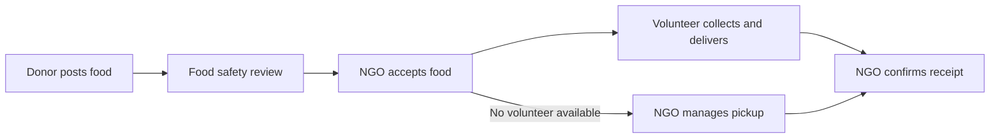

## Prepare the demo

You need Python 3.13 or later. From the repository root:

```bash
python -m venv .venv
source .venv/bin/activate          # Windows: .venv\Scripts\Activate.ps1
pip install -r requirements.txt
cp .env.example .env
python manage.py migrate
python manage.py seed_demo
python manage.py runserver
```

Open <http://127.0.0.1:8000/>. The local setup uses SQLite and needs no third-party
API keys.

`seed_demo` loads a safe demonstration dataset and prints every demo detail you
need: the shared password, login URL, demo URLs, and the IDs of the featured
`[DEMO]` listings. **Use those freshly printed IDs during the demo** — IDs change
each time you re-seed.

### Demo accounts

Every demo account uses the same password: **`FoodBridgeDemo123!`**
(this is the password printed by `seed_demo`).

| Role | E-mail | What it demonstrates |
| --- | --- | --- |
| Donor | `demo.donor@foodbridge.local` | Dashboard, food listings, statuses, delivery evidence |
| Volunteer | `demo.volunteer@foodbridge.local` | Available pickups, live location, in-transit work, delivery history, payout profile |
| Approved NGO | `demo.ngo@foodbridge.local` | Available food, safety review, takeover, receipt, delivery confirmation |
| Pending NGO | `demo.pending-ngo@foodbridge.local` | Approval-pending dashboard (access restricted until a staff member approves) |

---

## The script

### Act 1 · Public entry points — 1 min

**Do:** Open <http://127.0.0.1:8000/>. Show the landing page, then **Join** to open
registration. Point out the three role choices — Donor, Volunteer, NGO — each with
its own registration form. Return to login instead of creating an account.

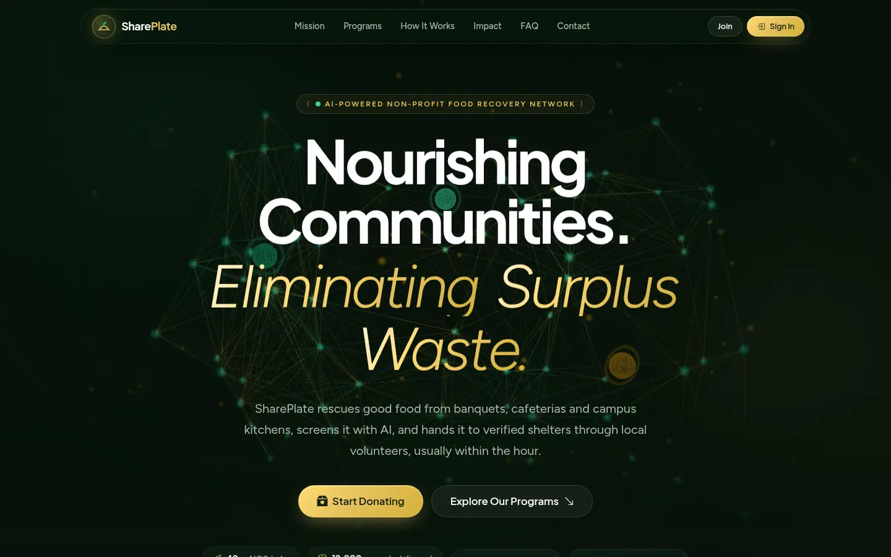
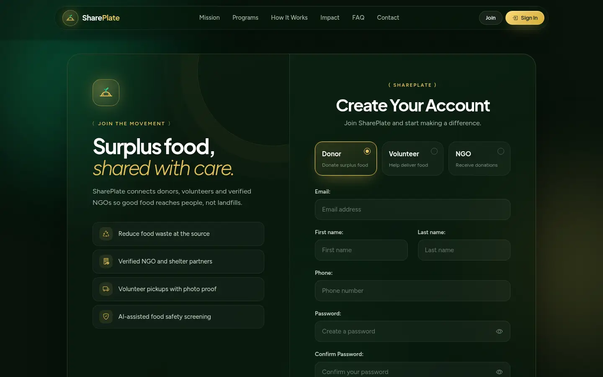

**Say:**

> SharePlate is a Django web application that connects people with surplus food
> to verified NGOs and volunteers. Every user is one of three roles, and each
> role gets its own workspace, permissions, and workflow.

**Details worth calling out:** the floating glass navbar, the PWA manifest
(installable on mobile), and that registration collects role-specific profile
data up front.

### Act 2 · Donor journey — 1.5 min

**Do:** Sign in as `demo.donor@foodbridge.local`. On the **Donor Dashboard** show
the quick stats: delivered count, total listings, pending pickups, NGOs reached.

Open the listing **`[DEMO] Available food listing`** from *My donations*
(example: `/donations/10/`). Walk through what a listing captures:

- three safety photos (overview, close-up, label)
- food type, condition, quantity, storage and allergen notes
- pickup window and pickup address with map coordinates

Opening **Donate food** (`/donations/new/`) shows the submission form, including
an AI visual screen on submitted photos and a voice-assisted form filler.

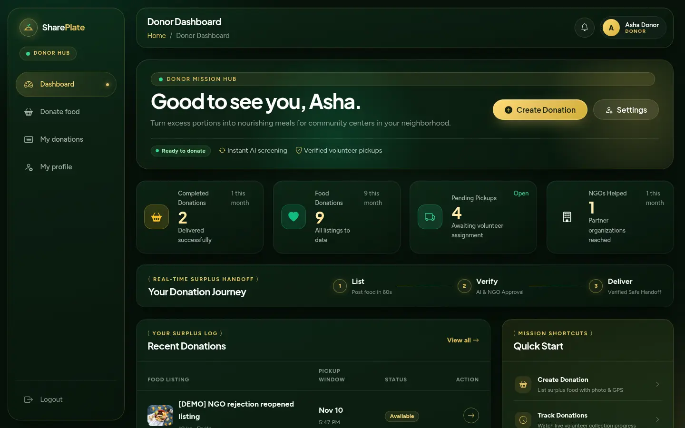
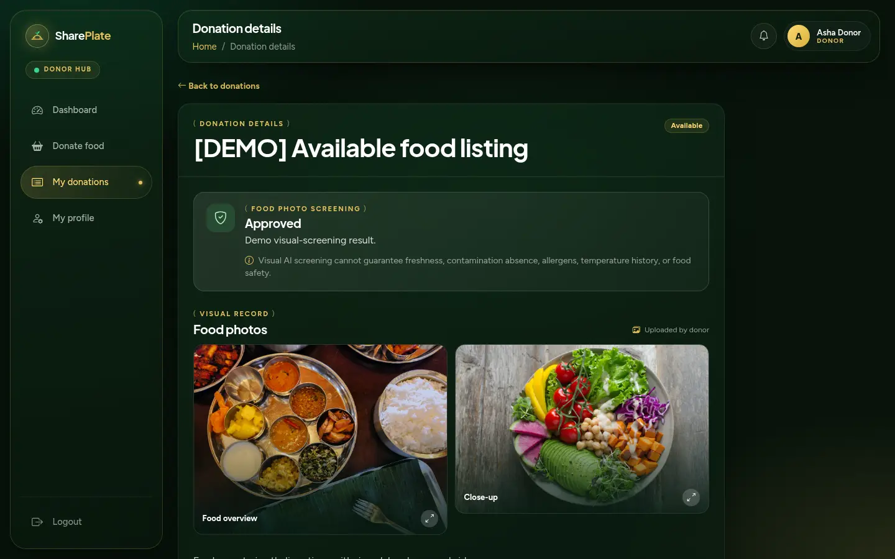
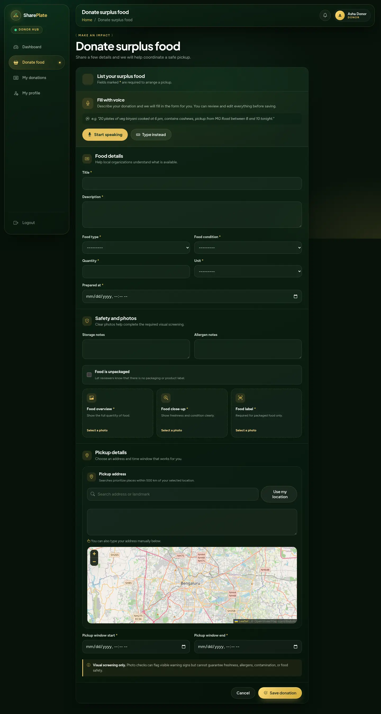

**Say:**

> A donor describes the food, sets a pickup window, and attaches up to three
> photos. The photos feed the safety-screening step you'll see in a moment.

### Act 3 · Access control — 1 min

**Do:** Sign out, sign in as `demo.pending-ngo@foodbridge.local`, and open the
dashboard. Show that the account exists but cannot operate on listings until a
staff member approves the NGO profile in Django admin.

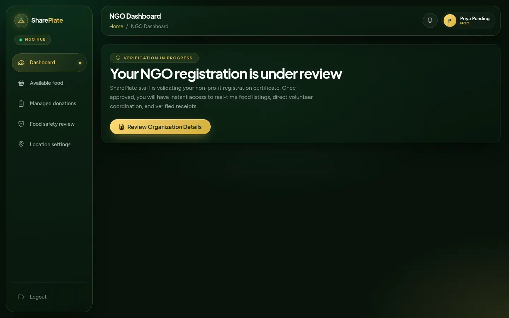

**Say:**

> Community trust is enforced in the product. A newly registered NGO can log in,
> but every action on a listing is gated behind staff approval of its profile.

### Act 4 · Food safety review — 1.5 min

**Do:** Sign out, sign in as `demo.ngo@foodbridge.local`, and open
<http://127.0.0.1:8000/donations/food-review/>.

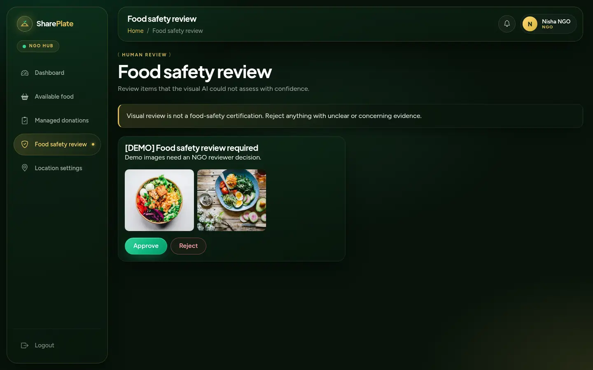

Show the listing `[DEMO] Food safety review required` waiting for a human
decision, and the separate `[DEMO] Food safety screening rejected` listing in the
donor's list. You may click **Approve** or **Reject** to show the action — rerun
`seed_demo` afterwards to restore the state.

**Say:**

> When a food photo is submitted, SharePlate can screen it with the Gemini
> vision API. Crucially, the system degrades gracefully: if the API key is not
> configured, or the model is not confident enough, the listing falls into this
> human review queue instead of being blocked. The banner reminds reviewers
> that visual review is not a food-safety certification.

### Act 5 · NGO food management — 1 min

**Do:** Show the NGO dashboard first, then open
<http://127.0.0.1:8000/donations/> — the available-food feed — and then
**Managed donations** (`/donations/managed/`).

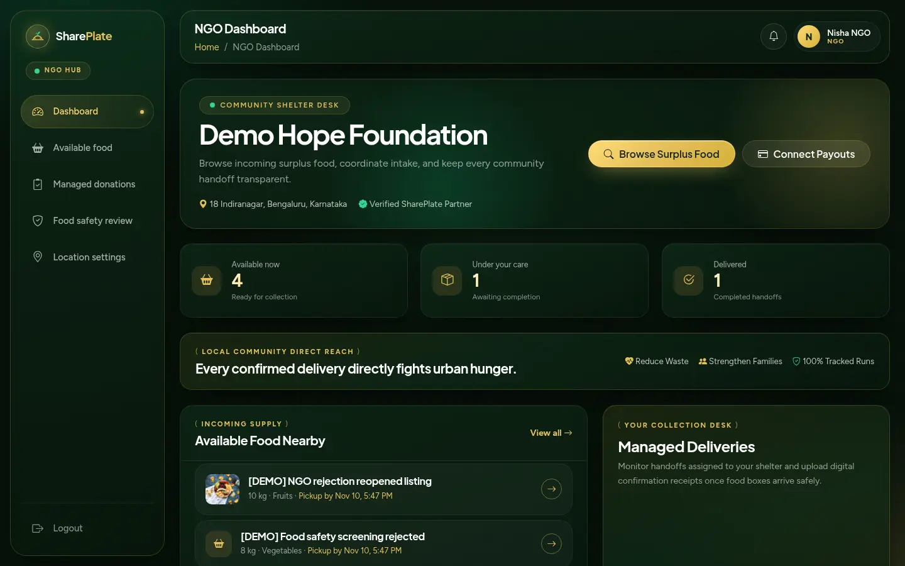

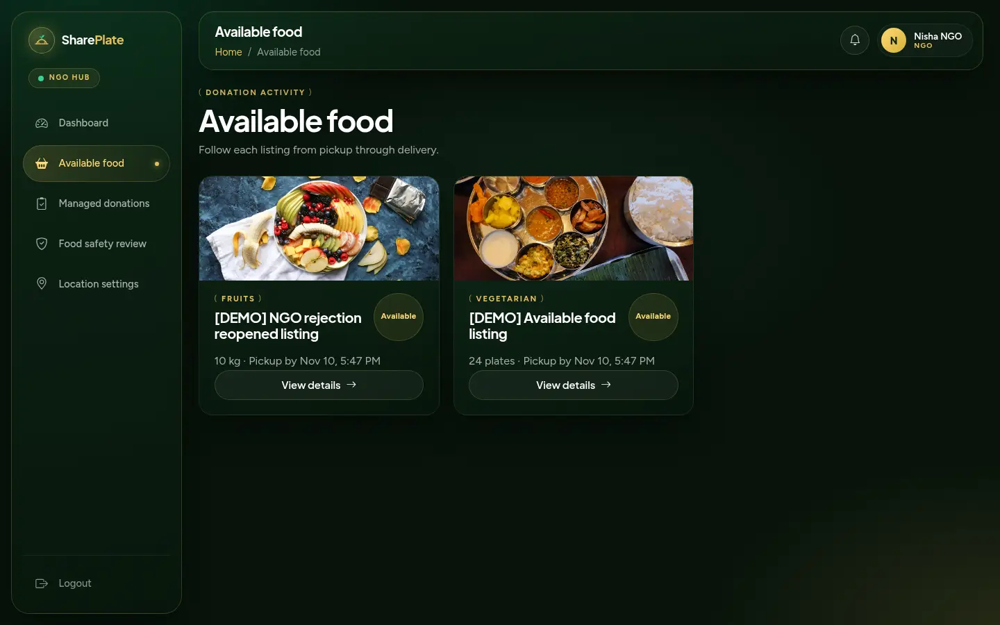
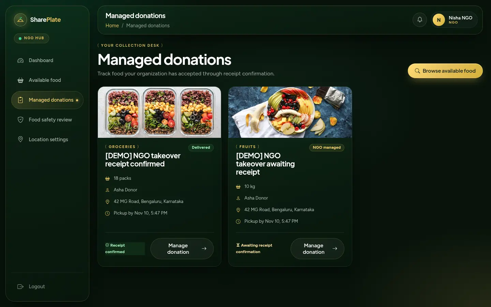

Open `[DEMO] NGO takeover awaiting receipt` to show the receipt-upload and
reject/return-to-queue options. Explain that this is the **NGO-managed path**:
when no volunteer is available, the NGO handles pickup itself. Do not submit an
external payment action.

### Act 6 · Volunteer collection — 2 min

**Do:** Sign out, sign in as `demo.volunteer@foodbridge.local`:

1. **Dashboard** (`/volunteer/dashboard/`) — show the available-pickup count and
   recent shared location.
2. **Available Pickups** (`/volunteer/pickups/`) — show
   `[DEMO] NGO accepted - ready for volunteer`; it is claimable because an NGO
   has already accepted it. Mention that a volunteer can hold only one active
   pickup at a time.
3. **Assigned Pickups** (`/volunteer/assigned/`) — open
   `[DEMO] Collected - live location` to explain collection, the delivery
   destination, and optional live location sharing.
4. **Pickup History** (`/volunteer/history/`) — open
   `[DEMO] Completed volunteer delivery` to show the delivery-proof photo and
   recipient details recorded on completion.

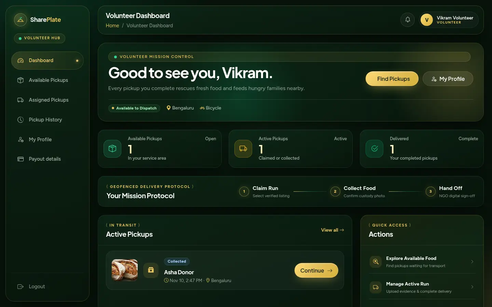
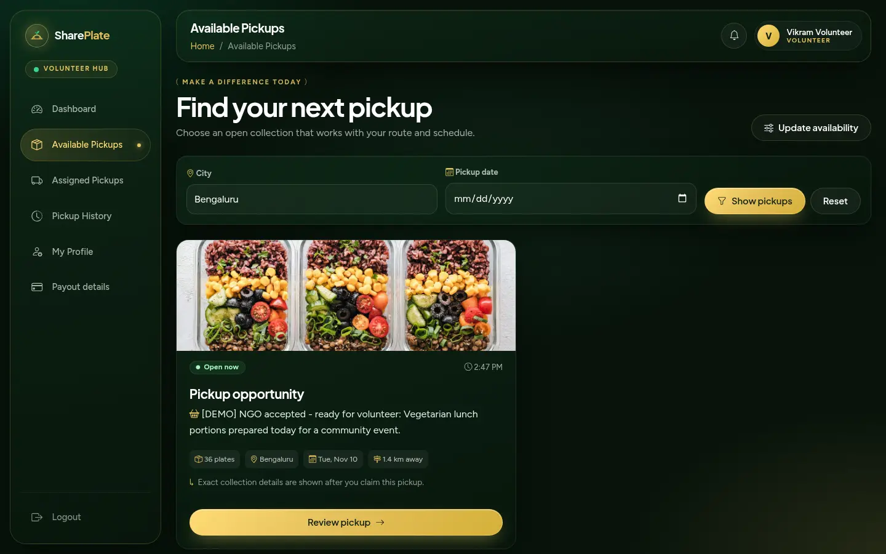
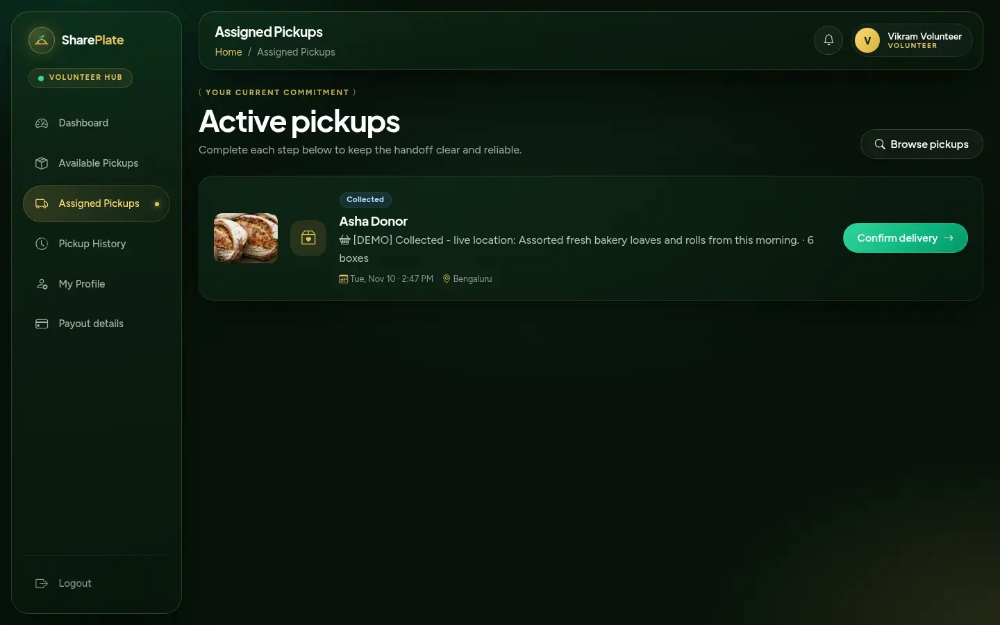
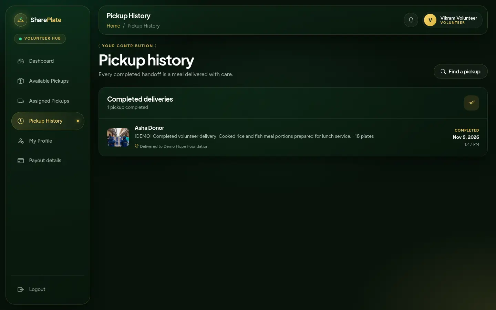

**Say:**

> The volunteer sees only pickups an NGO has accepted. After collecting the
> food, they mark it collected and, on delivery, upload a proof photo plus the
> recipient's details. The NGO then confirms receipt — closing the loop.

### Act 7 · Volunteer payments (optional) — 1.5 min

This feature is disabled by default. To show it, stop the server and re-run with
local-only payment settings:

```bash
PAYMENT_ENCRYPTION_KEY=local-demo-key FOODBRIDGE_PAYMENTS_ENABLED=true python manage.py seed_demo
PAYMENT_ENCRYPTION_KEY=local-demo-key FOODBRIDGE_PAYMENTS_ENABLED=true python manage.py runserver
```

`seed_demo` prints the **Payment detail** URL (example:
`/payments/volunteer-payments/2/`).

**Do (as the approved NGO):** open the printed payment URL — the completed,
simulated payment for the delivery (₹500 fixed delivery fee). Point out the
processed payout state in the timeline.

**Do (as the volunteer):** open **Payout details**
(`/payments/volunteer/payout-profile/`) to show the masked demo UPI destination.

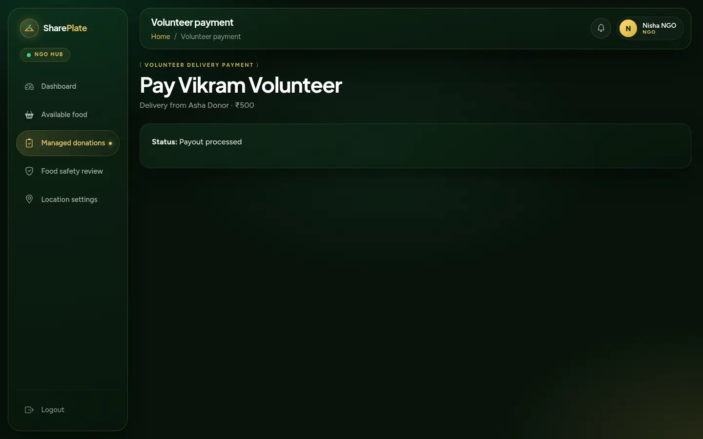
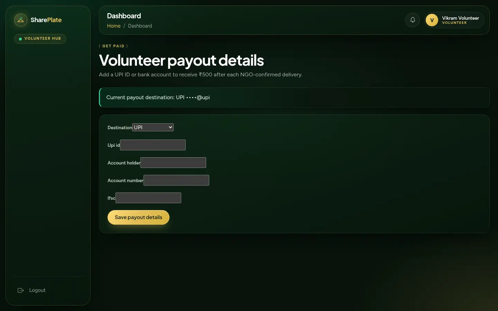

**Say:**

> NGOs can connect Razorpay, pay the ₹500 volunteer delivery fee on confirming
> a delivery, and volunteers configure a UPI or bank payout destination. Sensitive
> tokens and payout details are encrypted at rest. These screens show seeded,
> simulated records only — no real Razorpay transaction happens in a demo.

**Safety note:** do not click any payment, verify, or payout-release action
during the demonstration. The seeded record already represents the completed
end state.

### Act 8 · Confirmation and wrap-up — 1 min

**Do:** Return (as the approved NGO) to the completed-delivery listing from the
donor's list or the managed feed. Explain that the NGO confirms delivery before
a volunteer payment progresses. Recap on the flow diagram:


**Say:**

> From a donor's photo to a delivered meal, every step is tracked: status,
> timestamps, photos, and recipient records. That is the full SharePlate loop —
> in about ten minutes.

---

## Technical credibility (if the audience asks)

- **Stack:** Django 6 (server-rendered templates, no frontend build step),
  SQLite locally, PostgreSQL + WhiteNoise + Gunicorn in production via Docker.
- **Tests:** 73 test methods (~1,100 lines) across nine app test modules — run
  with `python manage.py test`. Also useful: `manage.py check` and
  `manage.py makemigrations --check --dry-run`.
- **Integrations, all optional:** Gemini food-photo screening and voice-form
  parsing, Razorpay/RazorpayX payouts, Photon geocoding with OpenStreetMap/Leaflet
  maps. The demo works with none of them configured.

## Reset and safety

- **Reset:** rerun `python manage.py seed_demo`. It refreshes only users whose
  e-mail starts with `demo.` and their linked demonstration records — it never
  touches other users or data, and it calls no external services (no Gemini,
  Razorpay, map, or geocoding requests).
- **Do not** enter real payout details or press any payment/payout action during
  the demonstration.
- **Stale demo data:** any walkthrough step that changes a demo record (for
  example approving a food-safety review) stays changed — re-run `seed_demo`
  before showing that screen again.

## Troubleshooting

| Symptom | Cause | Fix |
| --- | --- | --- |
| Login fails with the password above | Typo, or an old doc's password | Use exactly `FoodBridgeDemo123!` (what `seed_demo` prints) |
| Payment screens are 404 or links are hidden | `FOODBRIDGE_PAYMENTS_ENABLED` is off (it is off by default) | Restart both `seed_demo` and `runserver` with the two payment env vars from Act 7 |
| Payout screen shows an encryption error | Server running without `PAYMENT_ENCRYPTION_KEY` | Restart `runserver` with the encryption key from Act 7 |
| Demo listing missing or status seems wrong | A previous walkthrough step changed it | Re-run `python manage.py seed_demo` |
| Port already in use | Another server is running on 8000 | `python manage.py runserver 127.0.0.1:8001` and adjust URLs |
| IDs in example URLs don't match the listing titles | Seed IDs change on every re-seed | Use the IDs freshly printed by `seed_demo`, or navigate by clicking |

## See also

- [Project and workflow](project.md) — roles, donation lifecycle, capabilities
- [Development](development.md) — setup, configuration, useful commands
- [Backend](backend.md) — apps, request flow, permissions
- [Demo walkthrough (shorter companion guide)](demo-presentation.md)
