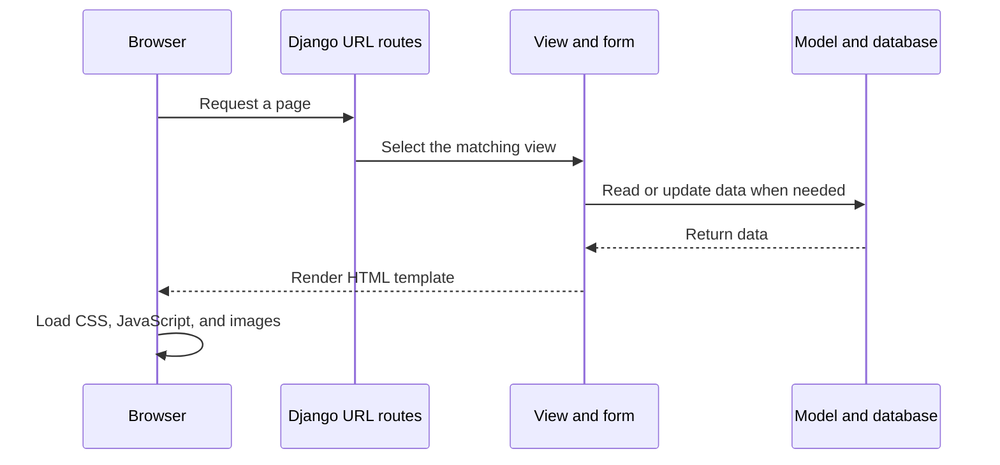

# Frontend

SharePlate uses Django-rendered HTML pages. Django fills templates with data from the backend and returns complete pages to the browser. There is no separate React or Vue application or frontend build step.

## Where things live

| Path | Purpose |
| --- | --- |
| `templates/` | Shared page layout, public pages, account pages, components, and role dashboards. |
| `<app>/templates/<app>/` | Templates used by a specific Django app, such as donation forms and listings. |
| `static/css/` | Page, dashboard, authentication, and visual styles. |
| `static/js/` | Browser behavior, including location controls, voice form assistance, and service worker code. |
| `static/img/` | Icons, backgrounds, and other image assets. |

`templates/base.html` is the shared page shell. Reusable navigation and dashboard elements live in `templates/components/`. Views choose a template and pass it the information the page needs.

## Page request

Forms submit back to Django. Views validate the input and permissions before saving changes. During production startup, `collectstatic` gathers static files and WhiteNoise serves them with Gunicorn.

## Making a UI change

1. Find the relevant URL and view in the feature's app.
2. Edit its template in `templates/` or the app's own template folder.
3. Put shared styling in the appropriate file under `static/css/`; put browser-side behavior in `static/js/`.
4. Keep access checks and data changes in the Django view or service, not in browser code alone.
