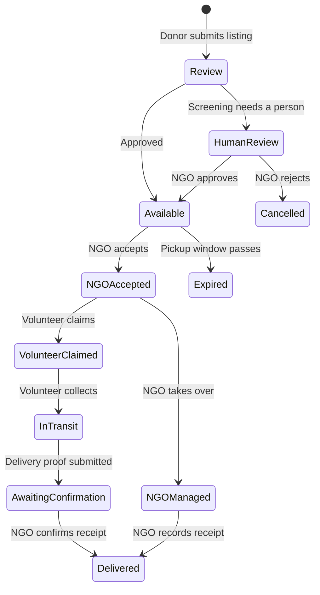

# Project and workflow

SharePlate is a web application for coordinating surplus food donations. It records who offered food, who accepted it, who collected it, and whether the receiving organization confirmed delivery.

## People and responsibilities

| Role | Main tasks |
| --- | --- |
| Donor | Create and track food listings; provide food, pickup, and contact details. |
| NGO | Review listings, accept food, select a volunteer delivery, or manage a pickup directly. Confirm receipt. |
| Volunteer | Browse eligible pickups, claim one, record collection, and submit delivery proof. |
| Staff | Review and approve NGO and volunteer profiles through the Django admin. |

## Donation journey

A listing can also be cancelled. Food photo screening uses an optional external service; it does not replace NGO review. If screening is unavailable or inconclusive, the listing can be routed for human review.

## What the project includes

- Separate dashboards and access rules for donors, NGOs, and volunteers.
- Food listings with quantity, condition, preparation time, pickup window, address, and photos.
- NGO and volunteer approval states.
- Pickup assignment, delivery evidence, and NGO receipt confirmation.
- Location search and optional volunteer location sharing.
- Optional Gemini food photo screening and optional Razorpay payment and payout features. Payments are disabled by default.

For the implementation, see [frontend](frontend.md), [backend](backend.md), and [database](database.md). For running the app, see [development](development.md) or [deployment](deployment.md).
