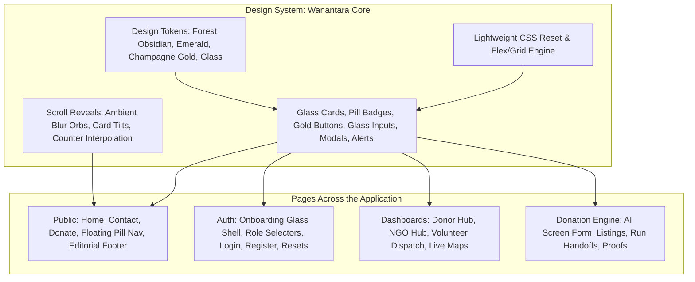

# FoodBridge — Wanantara NGO & Welcome Site Revamp Plan

## Goal Description
Transform the entire FoodBridge web application into an environmental non-profit / NGO welcome platform inspired by the **Wanantara Framer Template** (`https://www.framer.com/marketplace/templates/wanantara/`).

The revamp will:
1. **Retire Legacy Bootstrap CSS**: Remove `<link href="...bootstrap.min.css">` and replace it with a comprehensive, bespoke design system stylesheet (`wanantara.css` / modernized `style.css`, `dashboard.css`, `auth.css`) featuring a green, golden, and glass aesthetic.
2. **Apply Wanantara Design & Animations Everywhere**:
   - Palette: Deep forest obsidian (`#07120a`), moss surfaces (`#0d2215`, `#132f1d`), warm champagne gold (`#e5c05b`, `#d4af37`, `#ffdb73`), and vivid emerald (`#10b981`, `#34d399`).
   - Frosted Glassmorphism: Semi-transparent glass cards (`backdrop-filter: blur(20px)`), delicate hairline borders (`rgba(229, 192, 91, 0.2)` or `rgba(255, 255, 255, 0.08)`), ambient glow blobs.
   - Editorial Typography & Eyebrows: Figtree / Plus Jakarta Sans with signature Wanantara pill tags `( Mission )`, `( Focus Areas )`, `( Real-Time Impact )`, `( Get Involved )`.
   - Motion & Micro-interactions: Framer-like scroll reveals, card hover tilt & glow elevation, smooth metric counter animations, interactive FAQ accordions, and floating pill navigation.
3. **Revamp Every Single Page Across the Entire Application**:
   - Public pages: Home (`index.html`), Contact (`contact.html`), Donate (`donate.html`), Navigation & Footer.
   - Auth pages: Layout (`auth_layout.html`), Login (`login.html`), Register (`register.html`), Password reset flows.
   - Dashboards: Framework (`base_dashboard.html`), Donor dashboard & profile, NGO dashboard & profile, Volunteer dashboard, assigned/available runs, history, profile.
   - Donations & Pickups: Donation create form with Gemini AI safety preview, donation list & detail, review queue, volunteer run details, payout/receipt views.

---

## User Review Required

> [!IMPORTANT]
> **Complete Removal of Legacy Bootstrap CSS**:
> We are decoupling the frontend from `cdn.jsdelivr.net/.../bootstrap.min.css`. To ensure no layout breaks occur, our new stylesheet includes a custom lightweight grid/flex engine (`container`, `row`, `col-*`, `d-flex`, `gap-*`, spacing utilities) alongside custom form controls, glass cards, buttons, and alerts. Bootstrap JS bundle remains available only for data-bs-* accessibility or dropdowns, but all visual styling is 100% custom and Wanantara-styled.

> [!TIP]
> **Typography Upgrade**:
> We will import Google Fonts for **Figtree** and **Plus Jakarta Sans** to perfectly match the Wanantara Framer template's clean editorial typography and uppercase pill tags.

---

## Architecture & Visual System



---

## Proposed Changes

### Component 1: Design System & Core Stylesheet Architecture

#### [NEW] `static/css/wanantara.css`
A comprehensive, zero-dependency master stylesheet that:
- Defines the Wanantara token palette (`--bg-forest-900: #07120a`, `--bg-forest-800: #0b1a10`, `--bg-glass: rgba(13, 34, 21, 0.65)`, `--accent-gold: #e5c05b`, `--accent-gold-glow: rgba(229, 192, 91, 0.3)`, `--accent-emerald: #10b981`, etc.).
- Implements a modern CSS reset, container system, 12-column responsive flex grid (`row`, `col`, `col-sm-*`, `col-md-*`, `col-lg-*`, `col-xl-*`), flexbox utilities, and spacing scale.
- Provides Wanantara glassmorphism primitives (`.glass-panel`, `.glass-card`, `.glass-pill`, `.glass-input`, `.glass-table`).
- Provides Wanantara typography: signature parentheses tags `( Tag Name )`, bold headline treatments, muted subheadings.
- Provides Wanantara button hierarchy:
  - `.btn-wanantara-primary` (golden amber pill with dark forest text, smooth hover elevation).
  - `.btn-wanantara-emerald` (lush emerald pill with glow).
  - `.btn-wanantara-glass` (frosted glass outline with champagne hairline border).
- Provides custom dark glass form controls (`.form-control`, `.form-select`, `.form-check-input`, labels) with emerald/gold focus halos, completely eliminating ugly white browser inputs.
- Provides modern glass alerts, status badges, modals, and tooltips.

#### [MODIFY] `static/css/style.css`
- Streamline to build directly upon `wanantara.css`.
- Add Wanantara ambient glowing orbs, interactive 3D hero styling, feature showcase grids, community cards, and animated accordions.

#### [MODIFY] `static/css/dashboard.css`
- Revamp the entire dashboard theme to Wanantara NGO aesthetic:
  - Glass sidebar with pill navigation items and active golden status pips.
  - Floating topbar with ambient glass blur, notification drawer, and user identity pill.
  - Wanantara stat metric cards with golden number counters, micro-trend badges, and emerald icons.
  - Glass tables with gold/emerald status badges, action icons, and smooth hover rows.
  - Interactive Leaflet map container with glass coordinate HUD.

#### [MODIFY] `static/css/auth.css`
- Rebuild auth styling into an inspiring non-profit welcome shell:
  - Frosted glass authentication container with ambient radial blur orbs.
  - Role selection cards with gold active outline and radio check indicator.
  - Floating password reveals, glass fields, and sleek CTA buttons.

#### [MODIFY] `static/js/ui_effects.js`
- Enhance scroll reveal animations with Framer-style cubic-bezier easing (`cubic-bezier(0.16, 1, 0.3, 1)`).
- Add Wanantara accordion toggle interactions for FAQ sections.
- Enhance number counter easing with smooth decimal/integer interpolation.
- Add subtle cursor ambient glow and 3D card tilt micro-interactions.

---

### Component 2: Global Layouts & Base Templates

#### [MODIFY] `templates/base.html`
- Remove `<link href="...bootstrap.min.css">`.
- Add Google Fonts for **Figtree** (`family=Figtree:ital,wght@0,300..900;1,300..900`) and **Plus Jakarta Sans**.
- Link `wanantara.css` and revamped `style.css`.
- Update message alerts to use sleek Wanantara glass notifications with dismiss controls.

#### [MODIFY] `templates/dashboards/base_dashboard.html`
- Remove `<link href="...bootstrap.min.css">`.
- Link `wanantara.css`, `style.css`, and `dashboard.css`.
- Update dashboard wrapper to use floating glass sidebar, ambient blurred orbs, and glass topbar.

#### [MODIFY] `templates/components/navbar.html`
- Rebuild into a Wanantara floating pill navbar:
  - Rounded-full glass capsule floating centered at the top of the viewport.
  - FoodBridge brandmark with golden bridge/sprout icon.
  - Nav links with soft hover glows and active indicator dots.
  - Role-based dashboard button / sign in button in gold/emerald glass.

#### [MODIFY] `templates/components/footer.html`
- Revamp into an editorial non-profit footer:
  - NGO mission statement and sustainability credentials.
  - Quick directory navigation links.
  - Contact information and real-time response indicator.
  - Ambient divider and copyright notice.

#### [MODIFY] `templates/components/mobile_nav.html`
- Transform mobile bottom navigation into a frosted glass dock with active golden indicators.

---

### Component 3: Public & Welcome Pages

#### [MODIFY] `templates/index.html` (Home / Welcome Site)
Completely revamp to mirror the Wanantara NGO template structure:
1. **Hero Section**:
   - Status pill: `( AI-Powered Non-Profit Food Recovery Network )` with glowing pulse dot.
   - Welcoming editorial heading: *"Nourishing Communities. Eliminating Surplus Waste."*
   - Inspiring subtitle describing the NGO mission.
   - Primary Golden CTA (`Start Donating`) and Glass Secondary CTA (`Explore Our Programs`).
   - Floating live stats pills (`40+ NGO Hubs`, `12,000+ Meals Delivered`, `AI Safety Certified`, `< 45m Rapid Dispatch`).
2. **Mission & Vision Section (Wanantara Signature)**:
   - Bento layout with `( Mission )` and `( Vision )` glass cards.
   - Environmental and community hunger relief pillars.
3. **Focus Areas / Program Pillars (Wanantara 4-Card Grid)**:
   - 4 glass program cards with gold numbered tags `( 01 )`, `( 02 )`, `( 03 )`, `( 04 )`:
     - *Surplus Rescue & Rapid Dispatch*
     - *Gemini AI Food Safety Verification*
     - *Verified NGO & Shelter Redistribution*
     - *Carbon Mitigation & ESG Impact Auditing*
4. **Interactive 3-Step Journey (`From Surplus to Shared Table`)**:
   - Numbered step cards with custom icons and clear workflow explanation.
5. **Impact Statistics Counter**:
   - High-impact golden and emerald counters (`Meals Shared`, `Partner Shelters`, `Active Donors`, `Food Waste Prevented`).
6. **Community Impact Stories**:
   - Sleek editorial glass showcase featuring corporate, event, and community redistribution successes.
7. **FAQ Section (`Questions, answered`)**:
   - Interactive glass accordion with smooth toggle animations answering common donor, volunteer, and NGO questions.
8. **Call to Action**:
   - Inspiring full-width glass banner inviting visitors to register as Donors, Volunteers, or NGO Partners.

#### [MODIFY] `templates/contact.html` (Contact & NGO Inquiries)
- Restyle into a non-profit community outreach hub:
  - Hero with eyebrow `( Connect with Us )`.
  - Direct inquiry channels (Donor relations, NGO partnerships, Volunteer coordination).
  - Modern glass message form with glass inputs, role selector, and submission confirmation.
  - Local impact summary cards.

#### [MODIFY] `templates/donate.html` (Public Donation & Supporter Welcome)
- Redesign into an intuitive non-profit surplus donation intake portal:
  - Impact ticker at the top.
  - 3-step guideline cards.
  - Glass donation form with clean typography, responsive layout, and gold submission button.

---

### Component 4: Authentication Pages

#### [MODIFY] `templates/accounts/auth_layout.html`
- Frosted glass authentication shell with ambient background gradients.
- Non-profit mission highlights and community impact quote on the left.

#### [MODIFY] `templates/accounts/login.html`
- Sleek glass sign-in card with custom floating password toggle, remember me checkbox, and gold CTA.

#### [MODIFY] `templates/accounts/register.html`
- Redesigned role selector (Donor, Volunteer, NGO) with active gold borders and status badges.
- Glass form controls for personal and organization information.

#### [MODIFY] `templates/accounts/password_reset*.html`
- Update all 4 password reset templates (`password_reset.html`, `password_reset_done.html`, `password_reset_confirm.html`, `password_reset_complete.html`) with consistent glass styling and reassuring guidance.

#### [MODIFY] `templates/components/auth/*`
- Update `field.html`, `password.html`, `submit.html`, and `errors.html` to output Wanantara-styled form markup.

---

### Component 5: Dashboard Framework & Shared Components

#### [MODIFY] `templates/components/dashboard/sidebar.html`
- Rebuild as a glass sidebar with role badge pill, active item gold indicator, and smooth hover transitions.

#### [MODIFY] `templates/components/dashboard/navbar.html`
- Rebuild with glass search bar, notification indicator, and user profile pill with role badge.

#### [MODIFY] `templates/components/dashboard/stat_card.html`
- Wanantara metric card with bold golden value, emerald icon badge, and trend indicator.

#### [MODIFY] `templates/components/dashboard/activity_card.html`, `quick_action.html`, `section_header.html`, `welcome_banner.html`, `status_badge.html`, `empty_state.html`, `breadcrumb.html`
- Update all dashboard component partials to adhere strictly to the green/gold/glass design language.

#### [MODIFY] `templates/components/location_picker.html`
- Update map controls and address lookup bar with glassmorphic styling and emerald pin markers.

---

### Component 6: Role Dashboards & Feature Pages

#### [MODIFY] `templates/donors/dashboard.html` & `templates/donors/profile.html`
- Donor hub with impact metrics, active food donations table, recent pickups, and profile settings with location picker.

#### [MODIFY] `templates/ngos/dashboard.html` & `templates/ngos/profile.html`
- NGO management center with available food surplus queue, claimed distributions, distribution capacity, and verification status.

#### [MODIFY] `templates/volunteers/dashboard.html`, `assigned_pickups.html`, `available_pickups.html`, `pickup_details.html`, `pickup_history.html`, `profile.html`
- Volunteer mission control with live GPS status toggle, available pickup cards with distance badges, active run details with route map, photo proof upload, and completed runs history.

#### [MODIFY] `donations/templates/donations/form.html`, `detail.html`, `list.html`, `food_review_queue.html`, `ngo_managed.html`
- Multi-step donation creation form with image upload dropzone, Gemini AI safety preview, glass donation cards, and review queue.

#### [MODIFY] `templates/payments/payment_detail.html` & `templates/payments/payout_profile.html`
- Glass invoice / stipend receipts and payout settings cards.

---

## Verification Plan

### Automated Tests
Run the entire Django test suite to verify that all views, forms, authentication flows, and API endpoints continue to pass without error:
```bash
./.venv/bin/python manage.py test
```

### Manual Verification
1. **Public Site Verification**:
   - Load `http://127.0.0.1:8000/` (Home): Verify floating pill navbar, Wanantara hero, mission/vision bento, focus area cards, impact counters, FAQ accordion, and footer.
   - Load `/contact`: Test inquiry form and quick channels.
   - Load `/donate`: Test donation intake preview.
2. **Auth Flow Verification**:
   - Load `/login` and `/register`: Verify role selection toggle, glass styling, form validation feedback.
3. **Dashboard & Role Portals Verification**:
   - Log in as Donor, NGO, and Volunteer users.
   - Verify sidebar, topbar, metric cards, donation creation form, available pickups map, pickup details, and profile pages.
4. **Visual & Responsive Verification**:
   - Check responsive breakpoints on mobile (375px), tablet (768px), and desktop (1280px+).
   - Ensure zero visual glitches, no leftover default Bootstrap blue/grey styling, and smooth animations throughout.